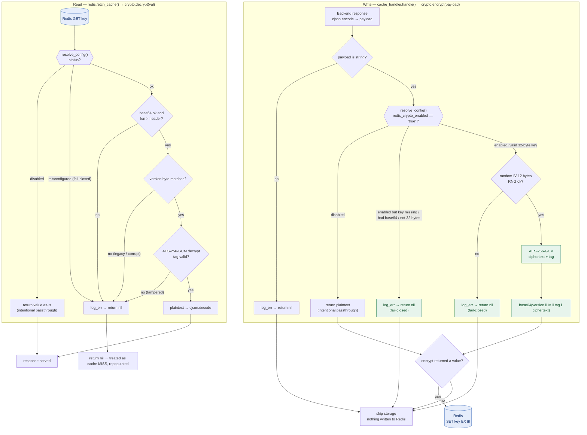

# NGINX Cache CDN - Modular Proxy with Redis, Lua, and Observability

## Overview

This project is a high-performance, modular CDN and HTTP cache solution based on **NGINX**. It uses Lua scripting for advanced cache logic, logging, metrics collection, and header manipulation. **Redis** is the cache backend, and **Prometheus** provides comprehensive traffic and cache metrics, ideal for Kubernetes or any environment prioritizing control, performance, and observability.

---

## Architecture

* **NGINX**: Acts as reverse proxy and main HTTP router.
* **Lua** (via [OpenResty](https://openresty.org/)): Advanced logic for caching, metrics, logging, and headers.
* **Redis**: Stores cached HTTP responses.
* **Prometheus**: Real-time metrics collection and exposure.
* **Full Modularization**: Logic, logging, headers, and caching behavior are maintained in external Lua modules and configuration files.

## Example Architecture


---

## Project Structure

* `nginx.conf`: Primary NGINX configuration.
* `log_format.conf`: JSON log format suitable for Elasticsearch integration.
* `http_globals.conf`: Global HTTP settings (performance, security, gzip).
* `maps.conf`: URI normalization and mapping.
* `http_settings_module_vhost_traffic_status.conf`: vhost traffic status settings.

### Lua Scripts

* `cache_handler.lua`: Redis cache logic.
* `prometheus_metrics.lua`: Prometheus metrics exporter.
* `body_logger.lua`, `headers_logger.lua`: Capture response/request logs.
* `add_header.lua`: Adds custom security/debug headers.
* `redis_key_invalidation.lua`: Cache key invalidation endpoint.

---

## Key Features

### 1. **Redis-Powered HTTP Caching**

* Cache keys based on request attributes (method, URI, headers, body).
* Distributed locking prevents cache stampedes.
* Supports serving stale cache when backend services fail.
* Manual cache invalidation via `/cache_invalidate` endpoint.

### 2. **Structured Logging**

JSON logging suitable for Elasticsearch:

```json
{
    "http_user_agent":"curl/8.14.1",
    "http_x_forwarded_for":"",
    "server_addr":"172.24.0.3",
    "vhost":"rickandmortyapi.com",
    "request_method":"GET",
    "request_uri":"/api/character/67",
    "request_headers":"accept: application/json; host: rickandmortyapi.com; user-agent: curl/8.14.1; ",
    "http_referer":"",
    "server_protocol":"HTTP/1.1",
    "request_time":"0.002",
    "upstream_response_time":"",
    "upstream_connect_time":"",
    "upstream_header_time":"",
    "status":"200",
    "request_body":"",
    "response_body":"{\"id\":67,\"name\":\"Collector\",\"status\":\"Alive\",\"species\":\"Alien\",\"type\":\"Light bulb-Alien\",\"gender\":\"Male\",\"origin\":{\"name\":\"The Menagerie\",\"url\":\"https://rickandmortyapi.com/api/location/25\"},\"location\":{\"name\":\"The Menagerie\",\"url\":\"https://rickandmortyapi.com/api/location/25\"},\"image\":\"https://rickandmortyapi.com/api/character/avatar/67.jpeg\",\"episode\":[\"https://rickandmortyapi.com/api/episode/29\"],\"url\":\"https://rickandmortyapi.com/api/character/67\",\"created\":\"2017-11-30T11:13:46.785Z\"}",
    "args":"",
    "cache_key":"09c488ee34e3d727def8100e47c7c53c",
    "cache_status":"HIT",
    "connection":"5260",
    "connection_requests":"1",
    "connection_time":"0.002",
    "connections_active":"1",
    "connections_reading":"0",
    "connections_waiting":"0",
    "connections_writing":"0"
}
```

### 3. **Advanced Metrics (Prometheus)**

* Metrics exposed at `/monitoring/metrics`.
* Detailed metrics per route, method, status, namespace, pod, and deployment.
* Easily integrated into Grafana dashboards.


### 4. **Security and Header Control**

* Preconfigured security headers.
* Debugging headers for monitoring.

### 5. **Observability & Debugging**

* Traffic status dashboard (`/monitoring/_nginx_status`).
* Health check endpoint (`/_nginx_healthcheck`).

### 6. **Route Normalization**

* `maps.conf` to normalize URIs for simplified monitoring.

---

## How to Use

### Prerequisites

* NGINX with [lua-nginx-module](https://github.com/openresty/lua-nginx-module) (e.g., OpenResty).
* Accessible Redis instance.
* Prometheus scraping from `/monitoring/metrics`.

### Quick Deployment

1. Clone repository and configure environment-specific settings.
2. Set Redis endpoints and cache variables in `vars.conf`.
3. Start NGINX (Docker, Kubernetes, VM).
4. Expose API (`8889`) and metrics (`8890`) ports.
5. \[Optional] Configure log forwarding (Elasticsearch, SIEM).

---

## Configuration (`vars.conf` Example)

```nginx
# Redis configuration
set $redis_host              "localhost";
set $redis_read_host         "localhost";
set $redis_write_host        "localhost";
set $redis_username          "nginx";
set $redis_password          "proxy";
set $redis_timeout           "1000";
set $redis_pool_size         "100";
set $redis_ttl               "3600";

# Cache configuration
set $cache_methods           "GET,HEAD";
set $cache_statuses          "200,203,204,206,301,404";
set $cache_headers           "Authorization";
set $cache_use_body_in_key   "false";
set $treat_head_as_get       "true";

# Redis value encryption (AES-256-GCM, at rest)
set $redis_crypto_enabled    "true";                   # on/off switch
set $redis_crypto_key        "<base64 32-byte key>";   # openssl rand -base64 32
```

---

## Redis Value Encryption

Cached values can be encrypted **at rest** in Redis at the application layer, so Redis — and its RDB/AOF dumps, memory, and replicas — only ever sees opaque bytes. It never handles plaintext and does not need to be aware encryption exists.

Encryption uses **AES-256-GCM** (an AEAD cipher: confidentiality **and** integrity). A fresh random 96-bit IV is generated per operation and, together with the authentication tag and a format-version byte, prefixed to the ciphertext:

```text
base64( version(1 byte) ‖ IV(12 bytes) ‖ tag(16 bytes) ‖ ciphertext )
```

Because the IV and tag travel **inside** the stored value, any pod or NGINX worker can decrypt what any other produced — the only requirement is the **same `redis_crypto_key` on every instance**. Transport security (the wire) is a separate concern, handled by TLS (`https://` / `wss://`), not by this layer.

### Configuration

| Variable | Role |
| --- | --- |
| `redis_crypto_enabled` | On/off switch — `"true"` enables; any other value means passthrough (stored/read in clear). |
| `redis_crypto_key` | The 32-byte AES-256 key used when enabled, base64-encoded. Generate with `openssl rand -base64 32`. |

> There is no static IV to configure: the IV is random per operation and prefixed to the payload.

### Decision topology



### Behavior summary

| Condition | `encrypt` / `decrypt` result | Effect |
| --- | --- | --- |
| `redis_crypto_enabled` ≠ `"true"` | passthrough | value stored/read in clear (by design) |
| enabled, key missing / invalid / ≠ 32 bytes | `nil` (**fail-closed**) | storage skipped and `log_err` emitted — never stores plaintext under a broken key |
| enabled, RNG failure | `nil` (fail-closed) | storage skipped; nothing written to Redis |
| enabled, valid key | GCM ciphertext | encrypted at rest |
| read: tampered / wrong version / legacy format | `nil` | treated as cache **MISS**, repopulated |

> **Key rotation.** Changing the key invalidates existing entries (they become MISSes and repopulate). The format-version byte allows introducing a new algorithm or key side by side during a migration.

---

## Creating a Cached Location

Define cached routes individually in `nginx.conf`, overriding global variables as needed:

```nginx
location /api/v1/colors {
    set $redis_ttl 1800;

    add_header Cache-Control public;
    add_header Pragma public;
    add_header Vary Accept-Encoding;
    expires 30m;

    content_by_lua_block {
        require("cache_handler").handle()
    }
}
```

### Variable Override Logic

* **Global Variables**: Default for all locations.
* **Local Overrides**: Specific route overrides take precedence.
* All variables in `vars.conf` can be overridden per route.

#### Example

Global `$redis_ttl` is `3600`:

* Without local overrides: uses global (`3600`).
* Local override (`set $redis_ttl 1800;`): route uses `1800`.

---

## Cache Invalidation

Manual cache invalidation can be performed by calling the dedicated invalidation endpoint:

```http
POST /cache_invalidate
Content-Type: application/json

{
  "keys": ["<cache_key_1>", "<cache_key_2>"]
}
```

You can also invalidate by sending HTTP request descriptors instead of precomputed cache keys. This is useful for external sidecars that know the affected route, but do not want to duplicate the cache key hash logic:

```http
POST /cache_invalidate
Content-Type: application/json

{
  "requests": [
    {
      "scheme": "https",
      "method": "GET",
      "uri": "/api/character/67",
      "headers": {},
      "cache_headers": "",
      "cache_use_body_in_key": false
    }
  ]
}
```

The proxy computes the same internal MD5 cache key used during storage and removes the matching Redis entries.

---

## Best Practices for Cached Routes

### Step 1: Define Cached Routes First

* Clearly list cached routes **before** the default (`location /`).

### Step 2: Default Route at End

* Always place `location /` at the end for fallback purposes.

### Benefits

* Optimized route matching performance.
* Enhanced readability and maintainability.

---

## Example: Cache MISS and HIT in Practice

When a client requests a resource for the first time, the cache is empty, resulting in a **MISS**. The response is fetched from the backend and stored. On subsequent identical requests, the cache is **HIT** and the content is served directly from Redis.

### 1️⃣ First Request (MISS)

**Request:**

```bash
curl -i http://localhost:8889/api/character/1 \
  -H "Host: rickandmortyapi.com" \
  -H "Accept: application/json"
```

**Response:**

```http
HTTP/1.1 200 OK
Content-Type: application/json; charset=utf-8
Connection: keep-alive
Vary: Accept-Encoding
X-Cache: MISS
Strict-Transport-Security: max-age=31536000
Etag: W/"a9f-I68Cx5oSPFclkl+Wy2Fr9jNsFS8"
Cache-Control: max-age=3600
X-Nf-Request-Id: 01JYMJ9RJYH7DK50E7XMTYM7WA
Expires: Wed, 25 Jun 2025 23:10:56 GMT
Cache-Status: "Netlify Edge"; hit
Content-Length: 2719
X-Powered-By: Express
Netlify-Vary: query
Access-Control-Allow-Origin: *
Age: 568
Date: Wed, 25 Jun 2025 22:10:56 GMT
X-Pod-Hostname: 2a4ce87f6375
Cache-Control: public
Pragma: public
vary: Accept-Encoding

{"id":1,"name":"Rick Sanchez","status":"Alive","species":"Human","type":"","gender":"Male","origin":{"name":"Earth (C-137)","url":"https://rickandmortyapi.com/api/location/1"},"location":{"name":"Citadel of Ricks","url":"https://rickandmortyapi.com/api/location/3"},"image":"https://rickandmortyapi.com/api/character/avatar/1.jpeg","episode":["https://rickandmortyapi.com/api/episode/1",...],"url":"https://rickandmortyapi.com/api/character/1","created":"2017-11-04T18:48:46.250Z"}
```

**Logs (`tail -f /var/log/nginx/error.log`):**

```text
⚠️ Request method: GET, client: 172.24.0.1, server: localhost, request: "GET /api/character/1 HTTP/1.1", host: "rickandmortyapi.com"
⚠️ Cacheable methods: GET,POST, client: 172.24.0.1, server: localhost, request: "GET /api/character/1 HTTP/1.1", host: "rickandmortyapi.com"
⚠️ Cacheable statuses: 200,201,204,400,401,403,404,422, client: 172.24.0.1, server: localhost, request: "GET /api/character/1 HTTP/1.1", host: "rickandmortyapi.com"
⚠️ Configured TTL: 3600, client: 172.24.0.1, server: localhost, request: "GET /api/character/1 HTTP/1.1", host: "rickandmortyapi.com"
⚠️ Generated Cache Key: cd4e850d2ce866f930c8c7eb3d000411, client: 172.24.0.1, server: localhost, request: "GET /api/character/1 HTTP/1.1", host: "rickandmortyapi.com"
⚠️ Lock successfully acquired: lock:cd4e850d2ce866f930c8c7eb3d000411, client: 172.24.0.1, server: localhost, request: "GET /api/character/1 HTTP/1.1", host: "rickandmortyapi.com"
⚠️ Cache missing for key: cd4e850d2ce866f930c8c7eb3d000411, client: 172.24.0.1, server: localhost, request: "GET /api/character/1 HTTP/1.1", host: "rickandmortyapi.com"
⚠️ Confirmed cache MISS, proceeding to backend: /api/character/1, client: 172.24.0.1, server: localhost, request: "GET /api/character/1 HTTP/1.1", host: "rickandmortyapi.com"
⚠️ Backend request: method = GET URI = /api/character/1, client: 172.24.0.1, server: localhost, request: "GET /api/character/1 HTTP/1.1", host: "rickandmortyapi.com"
⚠️ Backend response received with status: 200, client: 172.24.0.1, server: localhost, request: "GET /api/character/1 HTTP/1.1", host: "rickandmortyapi.com"
⚠️ Response saved to cache: cd4e850d2ce866f930c8c7eb3d000411, client: 172.24.0.1, server: localhost, request: "GET /api/character/1 HTTP/1.1", host: "rickandmortyapi.com"
⚠️ ✅ Finishing request, cleaning lock, client: 172.24.0.1, server: localhost, request: "GET /api/character/1 HTTP/1.1", host: "rickandmortyapi.com"
```

**Explanation:**

* First request results in a cache `MISS`.
* Full response is fetched from backend, stored in Redis, and returned to client with `X-Cache: MISS`.
* All processing steps are visible in the NGINX error log (using `tail -f`), which is essential for debugging and tracing cache behavior.

---

### 2️⃣ Second Request (HIT)

**Request:**

```bash
curl -i http://localhost:8889/api/character/1 \
  -H "Host: rickandmortyapi.com" \
  -H "Accept: application/json"
```

**Response:**

```http
HTTP/1.1 200 OK
Date: Wed, 25 Jun 2025 22:11:52 GMT
Content-Type: application/json; charset=utf-8
Transfer-Encoding: chunked
Connection: keep-alive
Vary: Accept-Encoding
Etag: W/"a9f-I68Cx5oSPFclkl+Wy2Fr9jNsFS8"
Cache-Control: max-age=3600
X-Cache: HIT
Expires: Wed, 25 Jun 2025 23:11:52 GMT
X-Pod-Hostname: 2a4ce87f6375
Cache-Control: public
Pragma: public
vary: Accept-Encoding

{"id":1,"name":"Rick Sanchez","status":"Alive","species":"Human","type":"","gender":"Male","origin":{"name":"Earth (C-137)","url":"https://rickandmortyapi.com/api/location/1"},"location":{"name":"Citadel of Ricks","url":"https://rickandmortyapi.com/api/location/3"},"image":"https://rickandmortyapi.com/api/character/avatar/1.jpeg","episode":["https://rickandmortyapi.com/api/episode/1",...],"url":"https://rickandmortyapi.com/api/character/1","created":"2017-11-04T18:48:46.250Z"}
```

**Logs (`tail -f /var/log/nginx/error.log`):**

```text
⚠️ Request method: GET, client: 172.24.0.1, server: localhost, request: "GET /api/character/1 HTTP/1.1", host: "rickandmortyapi.com"
⚠️ Cacheable methods: GET,POST, client: 172.24.0.1, server: localhost, request: "GET /api/character/1 HTTP/1.1", host: "rickandmortyapi.com"
⚠️ Cacheable statuses: 200,201,204,400,401,403,404,422, client: 172.24.0.1, server: localhost, request: "GET /api/character/1 HTTP/1.1", host: "rickandmortyapi.com"
⚠️ Configured TTL: 3600, client: 172.24.0.1, server: localhost, request: "GET /api/character/1 HTTP/1.1", host: "rickandmortyapi.com"
⚠️ Generated Cache Key: cd4e850d2ce866f930c8c7eb3d000411, client: 172.24.0.1, server: localhost, request: "GET /api/character/1 HTTP/1.1", host: "rickandmortyapi.com"
⚠️ Lock successfully acquired: lock:cd4e850d2ce866f930c8c7eb3d000411, client: 172.24.0.1, server: localhost, request: "GET /api/character/1 HTTP/1.1", host: "rickandmortyapi.com"
⚠️ Cache populated between lock and fetch: cd4e850d2ce866f930c8c7eb3d000411, client: 172.24.0.1, server: localhost, request: "GET /api/character/1 HTTP/1.1", host: "rickandmortyapi.com"
```

**Explanation:**

* Now the cache returns a `HIT`, serving the response directly from Redis with `X-Cache: HIT`.
* Backend is not called again for the same content.
* The logs confirm that the value was found in Redis and used for the reply.
* Use `tail -f /var/log/nginx/error.log` to monitor every cache access and debug real-time behavior.

---

> **Tip:**
> `tail -f /var/log/nginx/error.log` is essential for debugging.
> It lets you see the flow of each request, cache key computation, lock handling, backend access, and cache result (MISS or HIT) in real time.
> **Note:**
> By default, detailed log statements (`log_warn`) in the Lua scripts are usually commented out to reduce log noise.
> **To enable detailed debugging, uncomment the lines containing `log_warn` in your Lua modules (`cache_handler.lua` etc.) before using this feature.**

---
