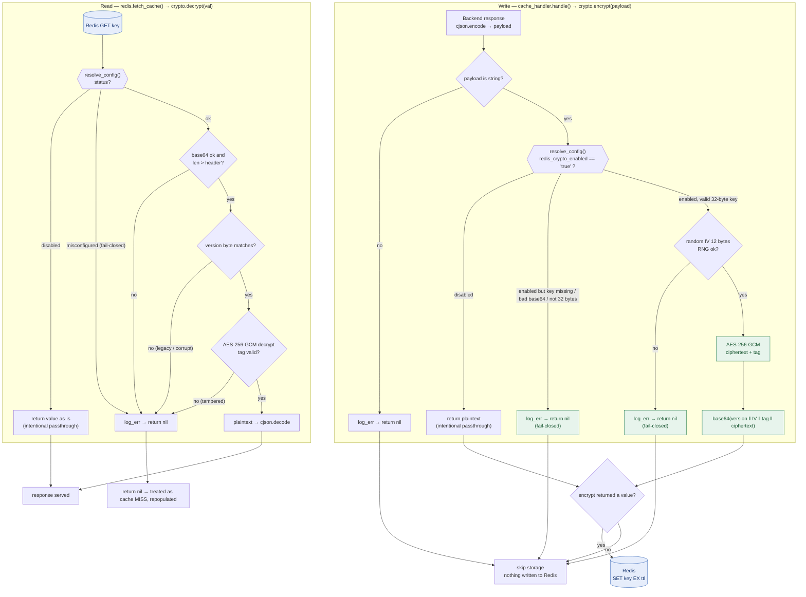

# NGINX Cache CDN - Modular Proxy with Redis, Lua, and Observability

## Overview

This project is a high-performance, modular CDN and HTTP cache solution based on **NGINX**. It uses Lua scripting for advanced cache logic, logging, metrics collection, and header manipulation. **Redis** is the cache backend, and **Prometheus** provides comprehensive traffic and cache metrics, ideal for Kubernetes or any environment prioritizing control, performance, and observability.

---

## Architecture

* **NGINX**: Acts as reverse proxy and main HTTP router.
* **Lua** (via [OpenResty](https://openresty.org/)): Advanced logic for caching, metrics, logging, and headers.
* **Redis**: Stores cached HTTP responses.
* **Prometheus**: Real-time metrics collection and exposure.
* **Full Modularization**: Logic, logging, headers, and caching behavior are maintained in external Lua modules and configuration files.

## Example Architecture


---

## Project Structure

* `nginx.conf`: Primary NGINX configuration.
* `log_format.conf`: JSON log format suitable for Elasticsearch integration.
* `http_globals.conf`: Global HTTP settings (performance, security, gzip).
* `maps.conf`: URI normalization and mapping.
* `http_settings_module_vhost_traffic_status.conf`: vhost traffic status settings.

### Lua Scripts

* `cache_handler.lua`: Redis cache logic.
* `prometheus_metrics.lua`: Prometheus metrics exporter.
* `body_logger.lua`, `headers_logger.lua`: Capture response/request logs.
* `add_header.lua`: Adds custom security/debug headers.
* `redis_key_invalidation.lua`: Cache key invalidation endpoint.

---

## Key Features

### 1. **Redis-Powered HTTP Caching**

* Cache keys based on request attributes (method, URI, headers, body).
* Distributed locking prevents cache stampedes.
* Supports serving stale cache when backend services fail.
* Manual cache invalidation via `/cache_invalidate` endpoint.

### 2. **Structured Logging**

JSON logging suitable for Elasticsearch:

```json
{
    "http_user_agent":"curl/8.14.1",
    "http_x_forwarded_for":"",
    "server_addr":"172.24.0.3",
    "vhost":"rickandmortyapi.com",
    "request_method":"GET",
    "request_uri":"/api/character/67",
    "request_headers":"accept: application/json; host: rickandmortyapi.com; user-agent: curl/8.14.1; ",
    "http_referer":"",
    "server_protocol":"HTTP/1.1",
    "request_time":"0.002",
    "upstream_response_time":"",
    "upstream_connect_time":"",
    "upstream_header_time":"",
    "status":"200",
    "request_body":"",
    "response_body":"{\"id\":67,\"name\":\"Collector\",\"status\":\"Alive\",\"species\":\"Alien\",\"type\":\"Light bulb-Alien\",\"gender\":\"Male\",\"origin\":{\"name\":\"The Menagerie\",\"url\":\"https://rickandmortyapi.com/api/location/25\"},\"location\":{\"name\":\"The Menagerie\",\"url\":\"https://rickandmortyapi.com/api/location/25\"},\"image\":\"https://rickandmortyapi.com/api/character/avatar/67.jpeg\",\"episode\":[\"https://rickandmortyapi.com/api/episode/29\"],\"url\":\"https://rickandmortyapi.com/api/character/67\",\"created\":\"2017-11-30T11:13:46.785Z\"}",
    "args":"",
    "cache_key":"09c488ee34e3d727def8100e47c7c53c",
    "cache_status":"HIT",
    "connection":"5260",
    "connection_requests":"1",
    "connection_time":"0.002",
    "connections_active":"1",
    "connections_reading":"0",
    "connections_waiting":"0",
    "connections_writing":"0"
}
```

### 3. **Advanced Metrics (Prometheus)**

* Metrics exposed at `/monitoring/metrics`.
* Detailed metrics per route, method, status, namespace, pod, and deployment.
* Easily integrated into Grafana dashboards.


### 4. **Security and Header Control**

* Preconfigured security headers.
* Debugging headers for monitoring.

### 5. **Observability & Debugging**

* Traffic status dashboard (`/monitoring/_nginx_status`).
* Health check endpoint (`/_nginx_healthcheck`).

### 6. **Route Normalization**

* `maps.conf` to normalize URIs for simplified monitoring.

---

## How to Use

### Prerequisites

* NGINX with [lua-nginx-module](https://github.com/openresty/lua-nginx-module) (e.g., OpenResty).
* Accessible Redis instance.
* Prometheus scraping from `/monitoring/metrics`.

### Quick Deployment

1. Clone repository and configure environment-specific settings.
2. Set Redis endpoints and cache variables in `vars.conf`.
3. Start NGINX (Docker, Kubernetes, VM).
4. Expose API (`8889`) and metrics (`8890`) ports.
5. \[Optional] Configure log forwarding (Elasticsearch, SIEM).

---

## Configuration (`vars.conf` Example)

```nginx
# Redis configuration
set $redis_host              "localhost";
set $redis_read_host         "localhost";
set $redis_write_host        "localhost";
set $redis_username          "nginx";
set $redis_password          "proxy";
set $redis_timeout           "1000";
set $redis_pool_size         "100";
set $redis_ttl               "3600";

# Cache configuration
set $cache_methods           "GET,HEAD";
set $cache_statuses          "200,203,204,206,301,404";
set $cache_headers           "Authorization";
set $cache_use_body_in_key   "false";
set $treat_head_as_get       "true";

# Redis value encryption (AES-256-GCM, at rest)
set $redis_crypto_enabled    "true";                   # on/off switch
set $redis_crypto_key        "<base64 32-byte key>";   # openssl rand -base64 32
```

---

## Redis Value Encryption

Cached values can be encrypted **at rest** in Redis at the application layer, so Redis — and its RDB/AOF dumps, memory, and replicas — only ever sees opaque bytes. It never handles plaintext and does not need to be aware encryption exists.

Encryption uses **AES-256-GCM** (an AEAD cipher: confidentiality **and** integrity). A fresh random 96-bit IV is generated per operation and, together with the authentication tag and a format-version byte, prefixed to the ciphertext:

```text
base64( version(1 byte) ‖ IV(12 bytes) ‖ tag(16 bytes) ‖ ciphertext )
```

Because the IV and tag travel **inside** the stored value, any pod or NGINX worker can decrypt what any other produced — the only requirement is the **same `redis_crypto_key` on every instance**. Transport security (the wire) is a separate concern, handled by TLS (`https://` / `wss://`), not by this layer.

### Configuration

| Variable | Role |
| --- | --- |
| `redis_crypto_enabled` | On/off switch — `"true"` enables; any other value means passthrough (stored/read in clear). |
| `redis_crypto_key` | The 32-byte AES-256 key used when enabled, base64-encoded. Generate with `openssl rand -base64 32`. |

> There is no static IV to configure: the IV is random per operation and prefixed to the payload.

### Decision topology



### Behavior summary

| Condition | `encrypt` / `decrypt` result | Effect |
| --- | --- | --- |
| `redis_crypto_enabled` ≠ `"true"` | passthrough | value stored/read in clear (by design) |
| enabled, key missing / invalid / ≠ 32 bytes | `nil` (**fail-closed**) | storage skipped and `log_err` emitted — never stores plaintext under a broken key |
| enabled, RNG failure | `nil` (fail-closed) | storage skipped; nothing written to Redis |
| enabled, valid key | GCM ciphertext | encrypted at rest |
| read: tampered / wrong version / legacy format | `nil` | treated as cache **MISS**, repopulated |

> **Key rotation.** Changing the key invalidates existing entries (they become MISSes and repopulate). The format-version byte allows introducing a new algorithm or key side by side during a migration.

---

## Creating a Cached Location

Define cached routes individually in `nginx.conf`, overriding global variables as needed:

```nginx
location /api/v1/colors {
    set $redis_ttl 1800;

    add_header Cache-Control public;
    add_header Pragma public;
    add_header Vary Accept-Encoding;
    expires 30m;

    content_by_lua_block {
        require("cache_handler").handle()
    }
}
```

### Variable Override Logic

* **Global Variables**: Default for all locations.
* **Local Overrides**: Specific route overrides take precedence.
* All variables in `vars.conf` can be overridden per route.

#### Example

Global `$redis_ttl` is `3600`:

* Without local overrides: uses global (`3600`).
* Local override (`set $redis_ttl 1800;`): route uses `1800`.

---

## Cache Invalidation

Manual cache invalidation can be performed by calling the dedicated invalidation endpoint:

```http
POST /cache_invalidate
Content-Type: application/json

{
  "keys": ["<cache_key_1>", "<cache_key_2>"]
}
```

Example with `curl`:

```bash
curl -i -X POST http://localhost:8889/cache_invalidate \
  -H "Content-Type: application/json" \
  -H "Host: rickandmortyapi.com" \
  -d '{
    "keys": [
      "cd4e850d2ce866f930c8c7eb3d000411"
    ]
  }'
```

You can also invalidate by sending HTTP request descriptors instead of precomputed cache keys. This is useful for external sidecars that know the affected route, but do not want to duplicate the cache key hash logic:

```http
POST /cache_invalidate
Content-Type: application/json

{
  "requests": [
    {
      "scheme": "https",
      "method": "GET",
      "uri": "/api/character/67",
      "headers": {},
      "cache_headers": "",
      "cache_use_body_in_key": false
    }
  ]
}
```

The proxy computes the same internal MD5 cache key used during storage and removes the matching Redis entries.

### Test the endpoint with k6 and follow the logs

The `k6.js` script also tests invalidation by request descriptor and by key, idempotent repeated deletion, a MISS after invalidation, and invalid payloads. To run the tests while following the endpoint logs:

1. In one terminal, follow the NGINX error log:

   ```bash
   docker compose exec nginx tail -f /var/log/nginx/error.log
   ```

2. In another terminal, run k6:

   ```bash
   docker compose run --rm k6
   ```

k6 prints the deletion response bodies; `tail` shows entries such as `Key removed` and `Total deleted` so you can compare the HTTP result with the NGINX log.

---

## Best Practices for Cached Routes

### Step 1: Define Cached Routes First

* Clearly list cached routes **before** the default (`location /`).

### Step 2: Default Route at End

* Always place `location /` at the end for fallback purposes.

### Benefits

* Optimized route matching performance.
* Enhanced readability and maintainability.

---

## Example: Cache MISS and HIT in Practice

Each pair of identical requests produces a **MISS** on the first request and a **HIT** on the next. The following output shows the corresponding NGINX logs (`tail -f /var/log/nginx/error.log`).

On a **MISS**, NGINX forwards the backend response headers, except `Connection` and `Transfer-Encoding`; `$cache_exclude_response_headers` does not filter this path. The variable is applied when a cached response is served on a **HIT**, allowing configured backend headers to be suppressed there. Headers added locally by NGINX, such as `X-Pod-Hostname` and the route's `Cache-Control`, are configured separately.

### 1️⃣ First Request (MISS)

The response is fetched from the backend and saved in Redis:

```bash
curl -I http://localhost:8889/api/character/1 \
  -H "Host: rickandmortyapi.com" \
  -H "Accept: application/json"
```

**Response:**

```http
HTTP/1.1 200 OK
Content-Type: application/json; charset=utf-8
Connection: keep-alive
X-Cache: MISS
referrer-policy: no-referrer-when-downgrade
x-content-type-options: nosniff
x-frame-options: SAMEORIGIN
x-xss-protection: 1; mode=block
CF-RAY: a4a743c69ef6f1c3-GRU
Nel: {"report_to":"cf-nel","success_fraction":0.0,"max_age":604800}
alt-svc: h3=":443"; ma=86400
Access-Control-Allow-Origin: *
ETag: W/"a9f-I68Cx5oSPFclkl+Wy2Fr9jNsFS8"
X-Proxy-Cache: HIT
Content-Length: 2719
cf-cache-status: HIT
Cache-Control: public, max-age=7776000, immutable
Report-To: {"group":"cf-nel","max_age":604800,"endpoints":[{"url":"https://a.nel.cloudflare.com/report/v4?s=Fi2ZMduFKU5pQLWpbK1Qf7gyTXRGQVNol5KXw9d1XVIhQqx8V7uF8fYxscZAmBn1q52jgKgW8qpyvEhgcGM8gXX9vgu4SUyMl9gCTDc4igEJEkN14bzVXUxpTF9xLHB9k7xtNjA8"}]}
Date: Wed, 14 Oct 2026 14:27:25 GMT
Accept-Ranges: bytes
Age: 6627235
expect-ct: max-age=86400, enforce
X-Pod-Hostname: 1a83023e8a7e
Cache-Control: public, max-age=300
Pragma: public
```

```text
ℹ️ Request method: GET, client: 172.18.0.1, server: localhost, request: "GET /api/character/1 HTTP/1.1", host: "rickandmortyapi.com"
ℹ️ Cacheable methods: GET,POST,HEAD, client: 172.18.0.1, server: localhost, request: "GET /api/character/1 HTTP/1.1", host: "rickandmortyapi.com"
ℹ️ Cacheable statuses: 200,201,204, client: 172.18.0.1, server: localhost, request: "GET /api/character/1 HTTP/1.1", host: "rickandmortyapi.com"
ℹ️ Configured TTL: 9999, client: 172.18.0.1, server: localhost, request: "GET /api/character/1 HTTP/1.1", host: "rickandmortyapi.com"
ℹ️ Generated Cache Key: cd4e850d2ce866f930c8c7eb3d000411, client: 172.18.0.1, server: localhost, request: "GET /api/character/1 HTTP/1.1", host: "rickandmortyapi.com"
⚠️ Cache missing for key: cd4e850d2ce866f930c8c7eb3d000411, client: 172.18.0.1, server: localhost, request: "GET /api/character/1 HTTP/1.1", host: "rickandmortyapi.com"
ℹ️ Lock successfully acquired: lock:cd4e850d2ce866f930c8c7eb3d000411 with owner: d5becd07e761470fb04ab3c3a63f908b, client: 172.18.0.1, server: localhost, request: "GET /api/character/1 HTTP/1.1", host: "rickandmortyapi.com"
ℹ️ Lock acquired with owner: d5becd07e761470fb04ab3c3a63f908b, client: 172.18.0.1, server: localhost, request: "GET /api/character/1 HTTP/1.1", host: "rickandmortyapi.com"
ℹ️ Backend request: method = GET URI = /api/character/1, client: 172.18.0.1, server: localhost, request: "GET /api/character/1 HTTP/1.1", host: "rickandmortyapi.com"
ℹ️ Backend response received with status: 200, client: 172.18.0.1, server: localhost, request: "GET /api/character/1 HTTP/1.1", host: "rickandmortyapi.com"
ℹ️ Response saved to cache: cd4e850d2ce866f930c8c7eb3d000411 (TTL: 9999s), client: 172.18.0.1, server: localhost, request: "GET /api/character/1 HTTP/1.1", host: "rickandmortyapi.com"
ℹ️ Finishing request, cleaning lock, client: 172.18.0.1, server: localhost, request: "GET /api/character/1 HTTP/1.1", host: "rickandmortyapi.com"
*4322 client 172.18.0.1 closed keepalive connection
```

### 2️⃣ Second Request (HIT)

The same request is served directly from Redis; the backend is not called again:

```bash
curl -I http://localhost:8889/api/character/1 \
  -H "Host: rickandmortyapi.com" \
  -H "Accept: application/json"
```

**Response:**

```http
HTTP/1.1 200 OK
Date: Wed, 14 Oct 2026 14:27:44 GMT
Content-Type: application/json; charset=utf-8
Connection: keep-alive
ETag: W/"a9f-I68Cx5oSPFclkl+Wy2Fr9jNsFS8"
Cache-Control: public, max-age=7776000, immutable
X-Cache: HIT
Referrer-Policy: no-referrer-when-downgrade
X-Content-Type-Options: nosniff
X-XSS-Protection: 1; mode=block
X-Frame-Options: SAMEORIGIN
X-Pod-Hostname: 1a83023e8a7e
Cache-Control: public, max-age=300
Pragma: public
```

```text
ℹ️ Request method: GET, client: 172.18.0.1, server: localhost, request: "GET /api/character/1 HTTP/1.1", host: "rickandmortyapi.com"
ℹ️ Cacheable methods: GET,POST,HEAD, client: 172.18.0.1, server: localhost, request: "GET /api/character/1 HTTP/1.1", host: "rickandmortyapi.com"
ℹ️ Cacheable statuses: 200,201,204, client: 172.18.0.1, server: localhost, request: "GET /api/character/1 HTTP/1.1", host: "rickandmortyapi.com"
ℹ️ Configured TTL: 9999, client: 172.18.0.1, server: localhost, request: "GET /api/character/1 HTTP/1.1", host: "rickandmortyapi.com"
ℹ️ Generated Cache Key: cd4e850d2ce866f930c8c7eb3d000411, client: 172.18.0.1, server: localhost, request: "GET /api/character/1 HTTP/1.1", host: "rickandmortyapi.com"
ℹ️ Cache HIT: cd4e850d2ce866f930c8c7eb3d000411, client: 172.18.0.1, server: localhost, request: "GET /api/character/1 HTTP/1.1", host: "rickandmortyapi.com"
ℹ️ Responding from cache [HIT], client: 172.18.0.1, server: localhost, request: "GET /api/character/1 HTTP/1.1", host: "rickandmortyapi.com"
7371 client 172.18.0.1 closed keepalive connection
```

> **Tip:** Follow `/var/log/nginx/error.log` to inspect the cache key, lock handling, backend access, and cache result (MISS or HIT) for each request.
